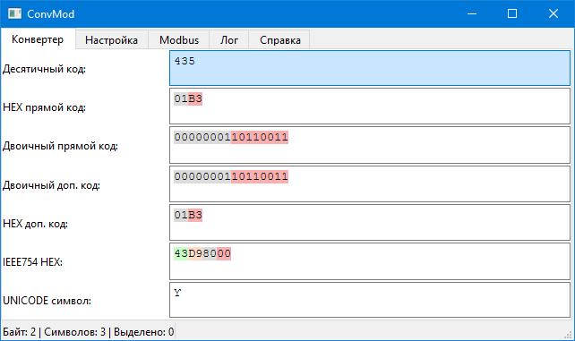
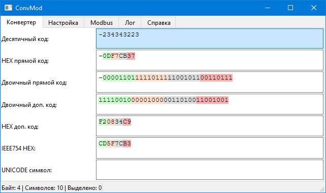
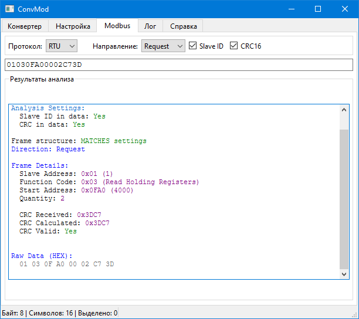

## ConvMod — Конвертер чисел и анализатор Modbus *

Приложение для конвертации чисел между различными форматами (десятичный, HEX, двоичный, IEEE754, Unicode, UTF-8) и анализа Modbus кадров (RTU, ASCII, TCP).**

## Возможности

### Конвертер чисел

- Десятичный код (целые и вещественные)
- HEX прямой и дополнительный код
- Двоичный прямой и дополнительный код
- IEEE754 (binary/hex) — 32-битный single precision
- Unicode и UTF-8 символы
- Подсветка байтов разными цветами

### Modbus анализатор

- Поддержка протоколов: RTU, ASCII, TCP **
- Определение направления: Request / Response
- Парсинг структуры кадра
- Проверка CRC16 (RTU) и LRC (ASCII) **
- Расшифровка кодов ошибок
- Логирование всех анализируемых команд

## Скриншоты

### Конвертер чисел



### Отрицательные числа



### Modbus анализатор



## Требования

- Python 3.11+
- PyQt6
- PyYAML

## Установка и запуск

```bash
git clone https://github.com/alexander13orlov/convmod.git
cd convmod
python -m venv venv
venv\Scripts\activate
pip install -r requirements.txt
python main.py
```

## Сборка EXE

```
pyinstaller ConvMod.spec
```

## Структура проекта

```
convmod/
├── main.py                 # Точка входа
├── config_manager.py       # Загрузка/сохранение настроек
├── converters.py           # Преобразование чисел
├── validators.py           # Валидация ввода
├── widgets/                # GUI компоненты
│   ├── base_field.py       # Базовое поле NumberField
│   ├── byte_field.py       # ByteGroupField (подсветка байтов)
│   ├── converter_widget.py
│   ├── highlighters.py     # Подсветка байтов
│   ├── log_widget.py       # Лог команд
│   ├── main_window.py      # Главное окно (вкладки)
│   ├── modbus_widget.py    # Виджет Modbus анализатора
│   ├── settings_widget.py  # Настройка видимых форматов
│   ├── help_widget.py      # Справка
│   └── modbus/             # Парсеры Modbus
│       ├── constants.py    # Коды функций/исключений
│       ├── modbus_parser.py# Фасад (выбор парсера по протоколу)
│       ├── parser_pdu.py   # Общий разбор PDU
│       ├── parser_tcp.py   # MBAP + PDU
│       ├── parser_rtu.py   # SlaveID + PDU + CRC16
│       ├── parser_ascii.py # ':' + hex + LRC + CRLF
│       └── display_groups.py
├── utils/font/             # Шрифт Hack + загрузчик (font_loader.py)
├── tools/                  # Отладочные скрипты
└── tests/                  # Юнит-тесты
```

## Тестирование

```
python run_tests.py
```

## Лицензия

MIT

*Код написан с помощью deepseek
** ASCII проверен: юнит-тесты + проверка LRC по эталонным кадрам
